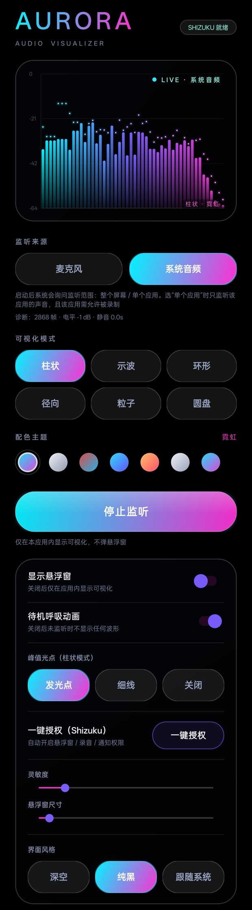

# Aurora Viz

Android 音频可视化应用：**悬浮窗 + 应用内双通道显示**，纯 Java 原生 Canvas 绘制，无第三方图形库。

> 版本：v3.1 (versionCode 21) · minSdk 26 / targetSdk 34 · 单 APK 约 110 KB



---

## 功能

### 可视化

| 项目 | 说明 |
|---|---|
| 6 种模式 | 柱状（带 dB 纵轴）、示波（零轴网格）、环形 96 柱、三层径向波形、64 点粒子云、56 瓣极坐标圆盘 |
| 7 套配色 | 霓虹 / 银色 / 彩虹 / 海洋 / 日落 / 极简 / 自定义 |
| 自定义调色 | HSV 色域板 + 色相条 + 三节点渐变（起始/中间/结束），实时预览 |
| 峰值弹道 | 参考 `audioMotion-analyzer` 默认值：hold 500 ms + fade 750 ms，纯时间驱动，与帧率/灵敏度解耦 |
| 峰值样式 | 发光粒子 / 细线 / 关闭，三态可选 |
| 待机动画 | 四层正弦合成 + 呼吸动画，可开关 |
| 纵轴 | 0 / -16 / -32 / -48 dB 刻度与网格 |

### 音频

| 项目 | 说明 |
|---|---|
| 麦克风 | `AudioRecord` + Hann 窗 FFT（2048 点），48 对数频带 40–16000 Hz，192 点波形 |
| 系统音频 | `AudioPlaybackCapture`（Android 10+），支持 Android 14 的「整个屏幕 / 单个应用」选择 |
| 平滑 | 快攻慢释（0.75 / 0.87），线程私有缓冲，每帧仅加锁一次 |
| 节拍检测 | 低频能量超过滑动均值 1.25 倍且间隔 > 180 ms |

### 悬浮窗

- 拖动移动、**位置记忆**（下次启动直接回到原位，带屏幕边界 clamp）
- 双击切换模式
- **双指捏合缩放**浮窗尺寸（160–660 dp，松手落盘）
- **长按隐藏**浮窗（不打断监听）
- **透明度** 25%–100% 实时可调
- **透明背景**：不画卡片底色，只留波形悬浮在桌面
- 右上角 ✕ **只隐藏浮窗、监听继续**
- 独立于监听的开关：可以只在应用内看可视化
- 实时诊断行：`N 帧 · 电平 X dB · 静音 Y s`，用于区分「0 帧（应用禁止被录制）」与「有帧但静音」

### 导出视频

「导出可视化视频（15 秒）」按钮：把当前模式/配色渲染成 **MP4**，保存到公共目录：

```
/sdcard/Movies/AuroraViz/aurora_yyyyMMdd_HHmmss.mp4
```

- 规格：960×540 · 30 fps · H.264 High · 约 700 kb/s（Android 10+ 通过 MediaStore 写入，相册可见）
- 录制中按钮显示剩余秒数，再次点击可提前结束（已录部分仍是完整可播文件）
- 管线：独立 `VisualizerView` → `Bitmap`(Canvas) → `GlBlitter`(OpenGL ES) → `MediaCodec` 输入 Surface → `MediaMuxer`
- 说明：MediaCodec 的输入 Surface **不能 `lockCanvas`**，必须走 GL；画面与界面上的实例分离，互不干扰

---

## 构建

环境要求：JDK 17、Gradle 8.9、Android SDK Platform 34、Build-Tools 34.0.0。

```bash
# 若 Gradle 无法自启 aapt2 daemon，需要显式指定 SDK 内的二进制
echo "android.aapt2FromMavenOverride=$ANDROID_HOME/build-tools/34.0.0/aapt2" >> gradle.properties

./gradlew :app:assembleDebug
# 产物：app/build/outputs/apk/debug/app-debug.apk
```

安装：

```bash
adb push app/build/outputs/apk/debug/app-debug.apk /data/local/tmp/av.apk
adb shell pm install -r /data/local/tmp/av.apk
```

> 直接 `adb install` 到 `/sdcard` 路径在部分设备上会因 FUSE 上下文报错，建议先 push 到 `/data/local/tmp`。

---

## 权限

| 权限 | 用途 |
|---|---|
| `RECORD_AUDIO` | 麦克风拾音 / 音频回放捕获 |
| `SYSTEM_ALERT_WINDOW` | 悬浮窗 |
| `FOREGROUND_SERVICE` + `MICROPHONE` / `MEDIA_PROJECTION` | 前台服务持续监听 |
| `POST_NOTIFICATIONS` | 常驻通知（Android 13+） |
| `WAKE_LOCK` | 息屏时保持采集 |
| `moe.shizuku.manager.permission.API_V23` | Shizuku 一键授权（可选） |

「一键授权（Shizuku）」会执行：`appops set ... SYSTEM_ALERT_WINDOW allow` 与 `pm grant` 录音/通知权限。

---

## 已知限制

**系统音频捕获无法录制「禁止被录音」的应用。**

若目标应用在 manifest 中声明 `android:allowAudioPlaybackCapture="false"`（国内主流音乐 App 普遍如此），系统层不会输出任何音频帧，UI 会显示 `0 帧` 并给出提示。这是 Android 平台的 DRM 级限制，Shizuku / adb / 重装都无法绕过，需要 root + `REMOTE_SUBMIX`。

区分方法看诊断行：

| 诊断读数 | 含义 |
|---|---|
| `0 帧 · 电平 -∞ dB` | 目标应用禁止被录制（系统级拒绝） |
| `669 帧 · 电平 -15 dB · 静音 0.0s` | 捕获正常 |

**导出的视频目前不含音轨**（v3.1）。录制只走视频编码，避免与系统音频捕获争用 `MediaProjection`；后续版本会加 PCM tee + AAC 混流。

---

## 代码结构

```
app/src/main/java/com/operit/audioviz/
├── MainActivity.java        设置界面：模式/配色/调色器/灵敏度/尺寸/开关
├── OverlayService.java      前台服务：悬浮窗 + AudioEngine 生命周期
├── AudioEngine.java         录音、FFT、频带/波形输出（单例）
├── VisualizerView.java      全部绘制：6 种模式 + 纵轴 + 峰值弹道 + 待机动画
├── Prefs.java               偏好读写
├── Scheme.java              调色板 → 实际颜色（自定义配色解析）
├── Palette.java / Style.java 配色与模式枚举
├── ChipView.java            胶囊选择按钮（渐变填充 + 纯色描边，双 Paint 分离）
├── GradientButton.java      主按钮（渐变 + 顶部高光 + 外发光）
├── GhostButton.java         次级按钮
├── SwatchView.java          圆形主题色块
├── SatValView.java          HSV 色域板
├── HueBar.java              色相条
├── ColorPickerDialog.java   三节点自定义调色面板
├── GlBlitter.java           OpenGL ES 桥：Bitmap → MediaCodec 输入 Surface
└── VideoRecorder.java       录制导出：独立 View → Bitmap → GL → H.264 → MP4（公共 Movies 目录）
```

### 一个值得记录的坑

`Paint.setColor()` 会同时设置 Paint 自身的 alpha，而 `setShader()` **不会重置** alpha，两者是**相乘**关系：

```java
paint.setColor(0x14FFFFFF);          // alpha = 20/255 ≈ 7.8%
paint.setShader(gradient);           // 渐变亮度被乘上 7.8% → 看起来是「发黑」
```

表现为「首帧正常、点一下就变黑」。项目内所有 `setShader(...)` 之前都强制 `setAlpha(255)`。

---

## 版本记录

| 版本 | 内容 |
|---|---|
| 1.0 | 首版：麦克风 + 系统音频捕获、4 种环形样式、悬浮窗 |
| 1.1 | 按参考项目重做 UI；移植环形/径向/粒子/圆盘 |
| 1.2 | 悬浮窗与应用内解耦；界面风格；银色/彩虹主题；纵向柱状 + 纵轴 |
| 1.3 | 修复柱状崩溃（待机合成值为负 → `pow(负数)` = NaN → 渐变坐标 NaN） |
| 1.5–1.7 | 峰值标记三态可选；改用像素间隙判据，修复低灵敏度闪烁 |
| 1.8 | 修复峰值样式标签与内部枚举错位（点「发光点」出现细线） |
| 1.9 | 峰值弹道改为时间驱动（hold 500 ms / fade 750 ms） |
| 2.0 | 待机不产生峰值；待机动画相位错开；布局重叠修复 |
| 2.1 | 自定义 HSV 调色（色域板 + 色相条 + 三节点渐变） |
| 2.2 | 实时诊断行（帧数 / 电平 / 静音时长） |
| 2.3 | 待机幅度提升、主题色块单行 7 个、按压反馈、待机动画开关 |
| 2.6 | **修复 Paint alpha 与 shader 相乘导致的「按钮变黑」**（13 处加固） |
| 2.7 | 峰值与柱共用 `pow(v,0.8)` 映射，光晕不跨柱（实测 179 点 0 异常） |
| 2.8 | **浮窗 ✕ 只隐藏不停止监听**，开关状态双向同步 |
| 3.0 | 浮窗增强：透明度、透明背景、位置记忆、双指缩放、长按隐藏；新增 MP4 录制导出 |
| 3.1 | 导出目录改为公共 `Movies/AuroraViz`（MediaStore，相册可见），不再写进 `Android/data` |

---

## License

MIT
